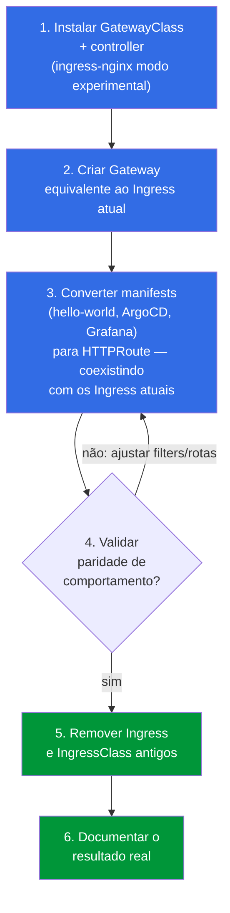

# Gateway API — funcionamento e plano de migração do Ingress-nginx

> Status: documentação preparatória. O cluster deste lab ainda usa `ingress-nginx` via recurso `Ingress`. Este documento registra como a Gateway API funciona e o caminho de migração, para execução numa fase futura.

## Por que migrar

`Ingress` (API `networking.k8s.io/v1`) resolveu só o caso básico de roteamento HTTP e delegou tudo o que é específico de implementação para annotations (`nginx.ingress.kubernetes.io/*`). Isso trava o manifest num controller específico e limita expressividade (ex.: não há suporte nativo a weighted routing, TCP/TLS roteado por conteúdo, ou delegação de papéis entre times).

A **Gateway API** (`gateway.networking.k8s.io`, GA desde 2023) é o sucessor oficial, mantido pelo SIG-Network do Kubernetes. Hoje é o padrão recomendado para novos clusters — inclusive o próprio projeto `ingress-nginx` já aponta a Gateway API como a direção futura do roteamento de tráfego no Kubernetes.

## Como funciona

A Gateway API separa responsabilidades em recursos distintos, ao contrário do `Ingress` que concentra tudo em um objeto:

| Recurso | Papel | Quem normalmente gerencia |
|---|---|---|
| `GatewayClass` | Define qual implementação/controller atende os Gateways (equivalente ao `IngressClass`) | Plataforma/infra |
| `Gateway` | Ponto de entrada: portas, protocolos (HTTP/HTTPS/TCP/TLS), certificados | Plataforma/infra |
| `HTTPRoute` | Regras de roteamento HTTP (path, header, host) para um ou mais `Gateway`s | Times de aplicação |
| `TCPRoute` / `TLSRoute` / `GRPCRoute` | Roteamento para outros protocolos | Times de aplicação |
| `ReferenceGrant` | Autoriza uma rota em outro namespace a referenciar um backend | Plataforma/infra |

Essa separação é o ganho principal: o time de infraestrutura mantém o `Gateway` (e o certificado, as portas expostas), enquanto cada time de aplicação só precisa criar `HTTPRoute`s no seu próprio namespace — sem precisar de permissão sobre o load balancer.

### Fluxo de uma requisição

```
Cliente → Gateway (porta 80/443, TLS termination)
            └─ HTTPRoute (match por host/path/header)
                 └─ backendRefs → Service → Pods
```

Isso é conceitualmente o mesmo fluxo do `Ingress` (client → controller → service → pods), mas o `Gateway` e as `*Route`s são objetos separados, versionados e com RBAC independentes.

## Mapeamento Ingress-nginx → Gateway API

| Ingress-nginx (hoje no lab) | Gateway API (equivalente) |
|---|---|
| `IngressClass: nginx` | `GatewayClass` |
| `Ingress.spec.rules[].host` + `.http.paths[]` | `HTTPRoute.spec.hostnames` + `.rules[].matches` |
| `Ingress.spec.tls` | `Gateway.spec.listeners[].tls` |
| `nginx.ingress.kubernetes.io/rewrite-target` | `HTTPRoute.spec.rules[].filters[].type: URLRewrite` |
| `nginx.ingress.kubernetes.io/canary-weight` | `HTTPRoute.spec.rules[].backendRefs[].weight` (nativo, sem annotation) |
| `nginx.ingress.kubernetes.io/ssl-passthrough` | `Gateway` listener com `protocol: TLS` + `mode: Passthrough` |

O ponto prático: **annotations proprietárias viram campos nativos e portáveis** da API. Isso é a principal motivação de portabilidade — o mesmo `HTTPRoute` funciona, em teoria, com qualquer implementação compatível (nginx, Envoy, Istio, Cilium, cloud LBs).

## Portabilidade real: o que muda ao trocar de implementação

A Gateway API garante **portabilidade de intenção** (o que você quer: "rotear /api para o backend X"), não portabilidade total e automática de infraestrutura. Na prática:

- `GatewayClass`, `Gateway` e `HTTPRoute` têm o mesmo formato entre implementações — isso é o que a conformance suite da Gateway API testa.
- Campos de implementação específica (ex.: tuning fino de timeouts, buffers) continuam existindo via **extension points** (`CRDs` ou `filters` específicos da implementação), não via annotation solta — mas ainda existem.
- Troca de implementação (ex.: `ingress-nginx` → `Istio` → `Cilium Gateway`) normalmente só exige trocar o `GatewayClass`/instalar o novo controller; `HTTPRoute`s continuam válidos sem reescrita, **desde que não usem filters proprietários**.

## Implementações compatíveis com `ingress-nginx` hoje

O projeto `kubernetes/ingress-nginx` tem suporte experimental à Gateway API desde a v1.11, mas o caminho mais maduro no ecossistema NGINX é o **NGINX Gateway Fabric** (projeto separado, mantido pela F5/NGINX, implementação Gateway API nativa — não é annotation-based). Opções ao migrar:

1. **NGINX Gateway Fabric** — troca direta de "filosofia", mesma empresa/base NGINX, mas um controller novo
2. **Manter ingress-nginx e adotar Gateway API experimental** — menor esforço de migração, mas suporte parcial
3. **Migrar para outra implementação** (Istio, Cilium, Envoy Gateway) — maior esforço, mais recursos (mTLS, observability nativa)

## Plano de migração proposto para este lab (fase futura)

1. Instalar `GatewayClass` + controller (começar com `ingress-nginx` em modo Gateway API experimental, para reaproveitar a instalação atual)
2. Criar `Gateway` equivalente ao Ingress atual (porta 80/443, mesmo mapeamento de `extraPortMappings` do `kind`)
3. Converter `manifests/apps/hello-world.yaml` e o Ingress do ArgoCD/Grafana para `HTTPRoute`, lado a lado com o `Ingress` atual (coexistência é suportada)
4. Validar paridade de comportamento
5. Remover os `Ingress` antigos e o `IngressClass`
6. Documentar aqui o resultado real da migração, incluindo qualquer filter proprietário necessário



## Referências

- https://gateway-api.sigs.k8s.io/
- https://kubernetes.io/blog/2023/10/31/gateway-api-ga/
- https://docs.nginx.com/nginx-gateway-fabric/
