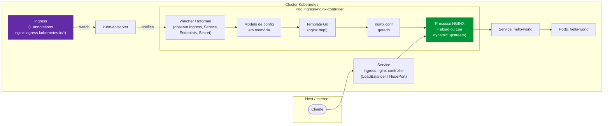
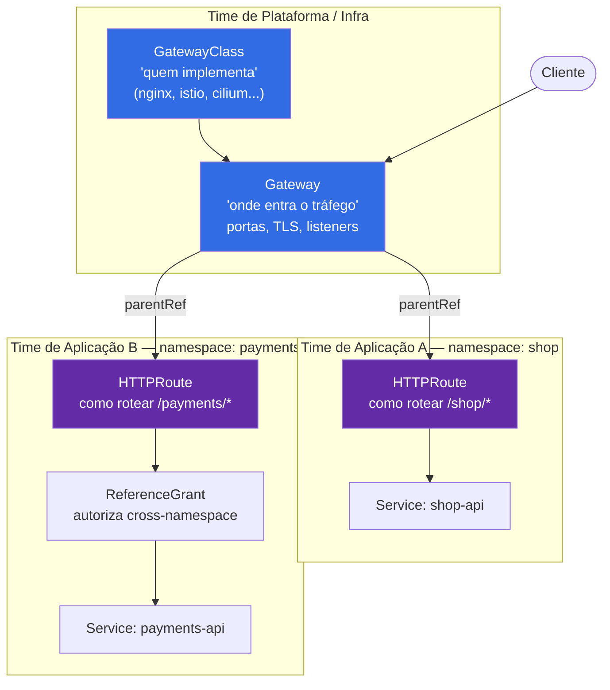
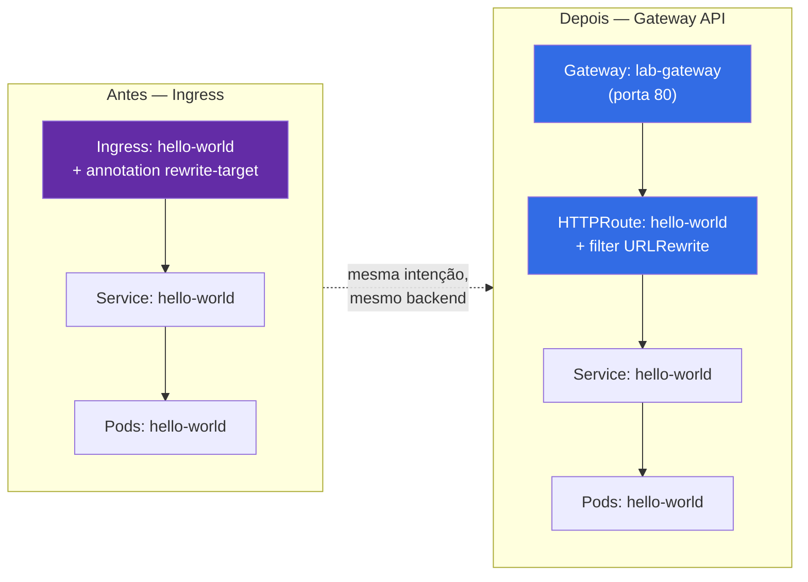
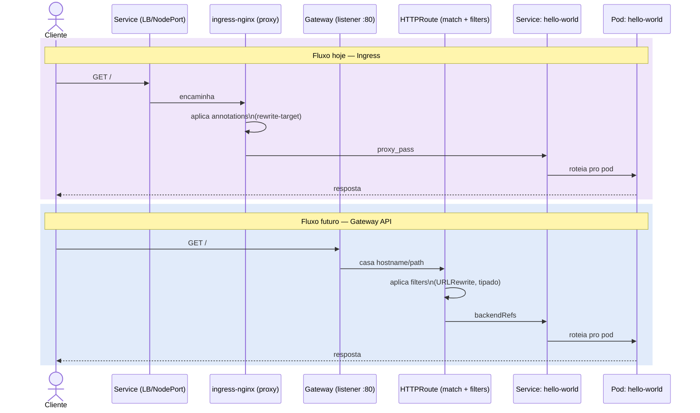
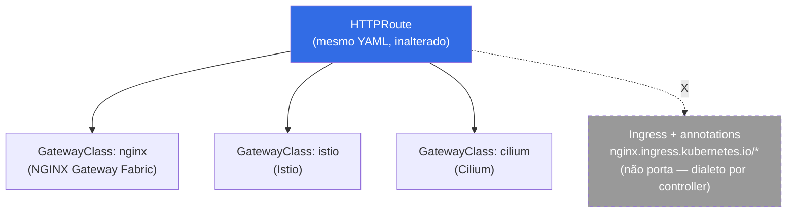

# Ingress-nginx vs. Gateway API — funcionamento e portabilidade

> Este documento aprofunda a arquitetura de cada modelo e mostra, com exemplos reais deste repositório, como portar `Ingress` para `Gateway API`. Complementa [`gateway-api.md`](gateway-api.md) (que foca no plano de migração) com o "como funciona por dentro" de cada um.

## 1. Como o Ingress-nginx funciona por dentro

O `ingress-nginx` não é um proxy "nativo" do Kubernetes — é um **controller** que roda como pod (`Deployment`) e observa a API do Kubernetes (`Ingress`, `Service`, `Endpoints`, `Secret`) via watch/informer. A cada mudança relevante:

1. O controller reconstrói, em memória, um modelo de configuração do NGINX a partir de todos os objetos `Ingress` do cluster que apontam para sua `IngressClass`
2. Esse modelo é renderizado num template Go (`nginx.tmpl`) e gera um `nginx.conf` real
3. O NGINX recarrega a configuração (`reload` ou, em versões recentes, via **Lua + dynamic upstreams**, evitando reload completo a cada mudança de endpoint)
4. O tráfego externo chega ao pod do controller via `Service` tipo `LoadBalancer`/`NodePort` (no nosso lab, via `extraPortMappings` do `kind`, que simula isso mapeando a porta do host direto pro container)



### O problema estrutural

O objeto `Ingress` (API `networking.k8s.io/v1`) só define **host + path + backend**. Tudo que o NGINX sabe fazer além disso (rewrite, canary, rate limit, CORS, auth) só é acessível via **annotations livres** (`nginx.ingress.kubernetes.io/*`) — texto não tipado, sem validação pelo apiserver, documentado só pelo projeto `ingress-nginx`, e que **não funciona em nenhum outro controller de Ingress** (Traefik, HAProxy, Contour têm seu próprio dialeto de annotations). É esse acoplamento que a Gateway API elimina.

## 2. Como a Gateway API funciona por dentro

A Gateway API também depende de um controller fazendo o trabalho real (nginx, Envoy, HAProxy por baixo continuam existindo — a Gateway API não substitui o proxy, substitui **a forma de configurá-lo**). A diferença é estrutural, em três pontos:

### a) Papéis separados por objeto (role-oriented API)



Um time de aplicação cria/edita só o `HTTPRoute` no seu namespace. Ele referencia um `Gateway` que já existe (gerenciado pela plataforma), sem precisar de RBAC sobre load balancer, certificado ou porta exposta. No modelo `Ingress`, isso tudo vive misturado no mesmo objeto.

### b) Campos tipados em vez de annotations

Comportamentos que no `ingress-nginx` são string em annotation passam a ser **campos validados pelo schema da API** — o apiserver rejeita um `HTTPRoute` malformado antes dele chegar ao controller:

```yaml
filters:
  - type: URLRewrite
    urlRewrite:
      path:
        type: ReplacePrefixMatch
        replacePrefixMatch: /
```

em vez de:

```yaml
annotations:
  nginx.ingress.kubernetes.io/rewrite-target: /
```

### c) Conformance suite

A Gateway API tem uma suite de testes de conformidade oficial (`sigs.k8s.io/gateway-api/conformance`) que qualquer implementação (nginx, Istio, Cilium, cloud LB) deve passar para se declarar compatível. Isso é o que garante que um `HTTPRoute` escrito contra "nginx" tenha alta chance de funcionar, sem reescrita, contra "Istio" depois — algo que nunca existiu para `Ingress` + annotations.

## 3. Portabilidade na prática — convertendo o `hello-world` deste repositório

### Hoje (`manifests/apps/hello-world.yaml`, via `ingress-nginx`)

```yaml
apiVersion: networking.k8s.io/v1
kind: Ingress
metadata:
  name: hello-world
  annotations:
    nginx.ingress.kubernetes.io/rewrite-target: /
spec:
  ingressClassName: nginx
  rules:
    - http:
        paths:
          - path: /
            pathType: Prefix
            backend:
              service:
                name: hello-world
                port:
                  number: 80
```

### Equivalente em Gateway API

```yaml
apiVersion: gateway.networking.k8s.io/v1
kind: Gateway
metadata:
  name: lab-gateway
  namespace: default
spec:
  gatewayClassName: nginx   # mesma implementação, API diferente
  listeners:
    - name: http
      port: 80
      protocol: HTTP
---
apiVersion: gateway.networking.k8s.io/v1
kind: HTTPRoute
metadata:
  name: hello-world
  namespace: default
spec:
  parentRefs:
    - name: lab-gateway
  rules:
    - matches:
        - path:
            type: PathPrefix
            value: /
      filters:
        - type: URLRewrite
          urlRewrite:
            path:
              type: ReplacePrefixMatch
              replacePrefixMatch: /
      backendRefs:
        - name: hello-world
          port: 80
```

**O que portou sem esforço:** path matching, backend reference, porta. **O que precisou de tradução explícita:** a annotation de rewrite virou um `filter` tipado — não é automático, mas é mecânico e documentado (não há mais dialeto por controller).

**O que NÃO muda:** o `Service`/`Endpoints`/`Deployment` do `hello-world` continuam exatamente iguais — a Gateway API só substitui a camada de roteamento, nunca o workload.

### Visão lado a lado da conversão



### Sequência de uma requisição, nos dois modelos



## 4. Tabela-resumo de portabilidade

| Aspecto | Ingress-nginx | Gateway API |
|---|---|---|
| Transporte de configuração | Annotations (string livre) | Campos de API tipados e validados |
| Portável entre controllers? | Não — annotations são por projeto | Sim — conformance suite garante o núcleo |
| Separação de responsabilidade | Um objeto para tudo | `Gateway` (infra) × `HTTPRoute` (app) |
| RBAC granular por time | Difícil (precisa de webhook/policy extra) | Nativo (namespaces + `ReferenceGrant`) |
| Suporte a weighted routing/canary nativo | Via annotation proprietária | Via `backendRefs[].weight` nativo |
| Protocolos | HTTP/HTTPS (TCP/TLS via annotation/ConfigMap) | HTTP, HTTPS, TLS, TCP, gRPC — cada um com `*Route` próprio |
| Maturidade no cluster atual | Em produção neste lab hoje | Planejada — ver roadmap |

## 5. Conclusão prática para este lab

A migração (detalhada em [`gateway-api.md`](gateway-api.md)) não vai exigir trocar o proxy por trás (`ingress-nginx` já tem suporte experimental à Gateway API) nem reescrever workloads — só a camada de roteamento. O ganho real é **portabilidade futura**: se este lab um dia trocar de `ingress-nginx` para `Istio` ou um Gateway de cloud, os `HTTPRoute`s sobrevivem; os `Ingress` com annotation não sobreviveriam.

### Portabilidade entre implementações — por que o `HTTPRoute` sobrevive


